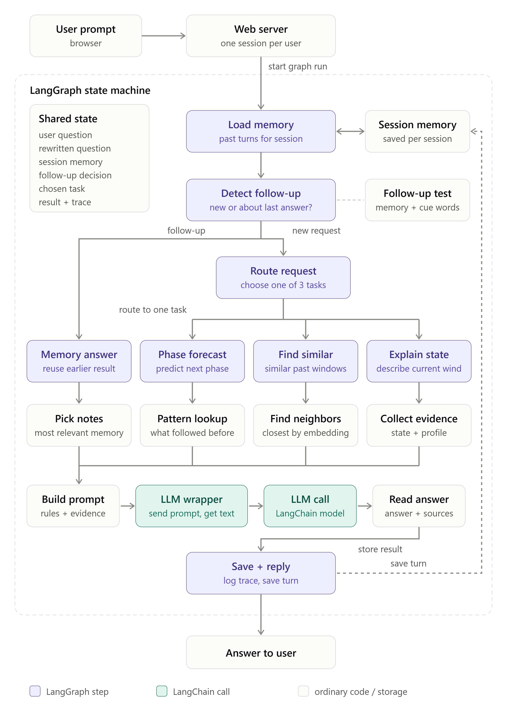

# Wind Phase Review Lab

An interactive wind forecasting application with retrieval-augmented generation
(RAG). It predicts wind patterns, finds similar past conditions, and uses a large
language model (LLM) to explain the results and answer follow-up questions.

[Try the live demo](https://wind-phase-review-demo.onrender.com/)

The public demo uses a fixed KBOS observation snapshot ending on 11 June 2026 at
05:54 UTC. It shows the software's workflow, not current weather forecasts.

## How it works

Each question goes through a small LangGraph state machine. The graph is
controlled, not free-form: a fixed set of steps passes a shared state from one
step to the next. The LLM never decides which step runs.

<p align="center">
  
</p>

### Step by step

**1. Session and memory.** The web server gives each user a session, and the
session ID is used as the conversation thread. The first step loads that
thread's past turns and last results from a small JSON memory file.

**2. Follow-up or new request?** The graph checks whether the question refers
back to the last answer, such as "why was this phase selected?". It does this
with simple rules: stored memory plus cue words in the question.

- **Follow-up:** the graph picks the most relevant notes from memory and asks
  the LLM to answer using only those notes. It does not run any task again.
- **New request:** a router picks one of three tasks by matching keywords in the
  question: predict the next wind phase, find similar past windows, or explain
  the current wind state.

**3. Task, evidence, then explanation.** Each task runs ordinary Python code
first:

- **Forecaster:** predicts the next wind phase with a Markov chain. It counts
  which phase followed the current one in past data.
- **Retriever:** finds the nearest historical windows using cosine similarity on
  embeddings.
- **Explainer:** collects the current state and its regime profile.

The result is an evidence pack. It is put into a prompt and sent to the LLM
through LangChain (`ChatOpenAI`). The LLM only turns the evidence into plain
language. It does not choose the task or change the prediction.

**4. Save and reply.** The final step stores the result and a short trace in
session memory, so the next question can build on it, and returns the answer.

**LangGraph and LangChain.** LangGraph manages the flow: steps, shared state and
routing. LangChain is only used as the LLM client inside those steps.

Built with Python, FastAPI, LangChain, LangGraph, scikit-learn, and Docker.

## Example questions

Start with `predict next phase`, `explain current live state`, or
`retrieve similar historical windows`.

After a forecast, ask `why was this phase selected?`. After retrieving past
windows, ask `what does d mean here?`. Use `Now answer it in bengali.` for a
Bengali answer. Suggested questions follow the current conversation.

## Run locally

Use Python 3.10. Configure your LLM provider's API key and model name for
explanations and follow-up answers. From this folder, run in PowerShell:

```powershell
python -m venv .venv
.\.venv\Scripts\python.exe -m pip install -r requirements.txt
$env:OPENAI_API_KEY = "your-api-key"
$env:SEMANTIC_LLM_MODEL = "your-model-id"
.\.venv\Scripts\python.exe deployment\server.py
```

Open [localhost:7860](http://127.0.0.1:7860). For an OpenAI-compatible provider,
also set `OPENAI_API_BASE` to its API URL before starting the server. Keep API
keys on the server and out of Git.

See [deployment setup](DEPLOYMENT.md) for hosting and [data provenance](DATA_CARD.md)
for the bundled observations. This is a research demo, not an operational weather
service. Code is available under the [MIT License](LICENSE).
